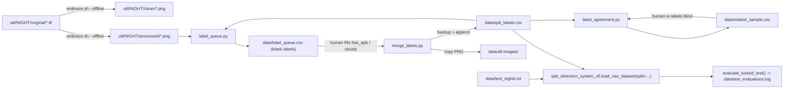

# Design Document: Night Data Preparation

## Overview

This spec prepares the dataset and tooling for adding new observation nights from EMBRACE, before any further change to Stage 2 (EPB classifier). It covers four items requested by the user:

- **Locked test split**: a set of observation nights reserved for a single, final evaluation, never used for any design decision.
- **Clean images for existing nights**: regenerate `clean/` (PNG without text burned into the pixels) for every night already in `code/util/`, without downloading anything.
- **Labeling protocol and agreement check**: a one-page protocol defining the labels, and a tool that samples frames for blind re-labeling and measures agreement (Cohen's kappa).
- **Labeling queue from existing nights**: list the frames already on disk in `code/util/*/` that are not yet in `data/epb_labels.csv` (the STR station is excluded for now; the user will label it separately), pick frames evenly spaced in time, and merge filled labels back into the CSV.

Out of scope (deferred by the user until more nights exist): star counting on TIF, temporal smoothing, re-evaluation of Stage 2, `app_v5` and code cleanup. Stage 2 code and training data are not changed. In particular, Stage 2 keeps training on `data/all-images` (annotated PNGs); switching to `clean/` is a later decision.

The previous step (commit of the current state and tag `v5-pre-noites`) is already done and is the reference point for comparisons.

### Design principles

- **The night is the unit.** All tools key frames by observation night, using `extract_night_groups` (frames before 12:00 UT belong to the night that started the previous day).
- **Nothing is destructive.** Tools never overwrite existing labels, images or the CSV without a backup, and never delete folders.
- **Every look at the test set is recorded.** The locked test set can only be scored through one function, which appends to a log.

## Architecture

## Components and Interfaces

### 1. Locked test split

**File `data/test_nights.txt`**: one night id per line (format `SITE_YYYYMMDD`, the night start date, same as `extract_night_groups`). Lines starting with `#` are comments. The file is created with instructions and an empty list: with only 7 labeled nights, none of them can be spared. The user fills it as new nights arrive, choosing them before looking at model results on them.

**Changes in `epb_detection_system_v5.py`**:

- `load_test_nights(path="data/test_nights.txt") -> set[str]`: parses the file; returns an empty set if the file is missing.
- `load_raw_dataset(..., split="dev")`: new parameter.
  - `"dev"` (default): excludes frames whose night is in the test set. All existing notebook cells keep working and automatically stop seeing test nights.
  - `"test"`: returns only test-night frames. Only `evaluate_locked_test` may call it.
  - `"all"`: no filtering (needed by the final model fit after the study ends).
  - Logs how many frames and nights were excluded.
- `evaluate_locked_test(make_model, note, ...) -> dict`: fits on all `dev` nights, predicts each test night, returns per-night accuracy and pooled metrics, and appends one line to `data/test_evaluations.log` with the timestamp, git commit hash, the test-night list, the `note` and the metrics. It refuses to run if the test set is empty.

### 2. Clean images for existing nights

**Change in `util/embrace.sh`**: new optional flag `--offline` (`./embrace.sh --offline <URL or NIGHT_DIR>`). With it, the script skips the listing and download steps and processes the TIFs already in `original/`. Today the same effect is obtained only when the listing fails, which depends on the network.

**New flag `--clean-only`** in `embrace.sh`: writes only `clean/` and skips `processed/` and the timelapse. Existing `processed/` files (used by `app_v4` figures and the sequence analyses) are left untouched; re-rendering them would change the text pixels slightly (font rasterization) for no benefit.

**New `util/regen_clean.sh`**: loops over every `util/*/original/` folder and calls `embrace.sh --offline --clean-only` for it. At the end it prints, per night, the number of TIFs, `clean/` PNGs and `processed/` PNGs, and exits with an error if `clean/` has fewer files than `original/`.

A verification step compares, for every frame, `clean/` against `processed/` inside the circular field of view (where no text is drawn): they must differ by at most 1 gray level. Frames that fail are listed.

### 3. Labeling protocol and agreement check

**File `data/LABELING_PROTOCOL.md`** (one page, Portuguese), with:

- Label definitions, matching the CSV columns:
  - `has_epb=1`: at least one depletion band (dark, elongated, roughly north–south) visible in the field of view.
  - `has_epb=0`: clear sky, no depletion band.
  - `cloudy=1` with `has_epb` empty: the sky is obscured so that the presence of EPB cannot be judged ("Indeterminado").
  - Partial cloud: if a bubble is visible in the clear part, label `has_epb=1, cloudy=0`; if the clear part shows no bubble but most of the sky is hidden, label as cloudy.
- Boundary rule for the start and end of an event: label 1 from the first frame where the band is recognizable; doubtful frames go to `cloudy` only if the doubt comes from the sky, otherwise they are skipped and listed in a `notes` column.
- Sampling rule per night: 15 to 20 frames, evenly spaced in time over the whole night, plus all frames in the 30 minutes around a start or end of an event.
- The rule that test nights (`data/test_nights.txt`) are chosen before any model result on them is seen.
- How to run the agreement check and what kappa values mean (below 0.6 means the definitions need revision before more labeling).

**New `util/label_agreement.py`** with two subcommands:

- `sample --n 50 --seed 42`: draws `n` labeled frames stratified by night (proportional, at least 2 per night), shuffles them and writes `data/relabel_sample.csv` with columns `filename, night, has_epb, cloudy, notes` where the label columns are **empty**, so the second pass is blind.
- `score data/relabel_sample.csv`: compares the re-labels with `epb_labels.csv` on a three-class label (`EPB`, `Sem EPB`, `Indeterminado`), prints the confusion table, raw agreement and Cohen's kappa (overall and per night), and writes the disagreements to `data/relabel_disagreements.csv`.

### 4. Labeling queue from existing nights

**New `util/label_queue.py`**:

- Scans `util/*/processed/*.png` (the annotated images, which show date and time and are easier for a human to read).
- Drops frames already in `epb_labels.csv`.
- Skips stations listed in `--exclude-sites` (default: `STR`).
- Per night, picks `--per-night` frames (default 20) evenly spaced in time among the unlabeled ones; `--all` keeps every unlabeled frame.
- Writes `data/label_queue.csv` with `filename, night, site, path, has_epb, cloudy, notes` (labels empty) and, per night, a contact sheet `data/label_queue_sheets/NIGHT.png` (frames in time order with their time stamp) to speed up labeling.
- Prints a summary table: per night, frames on disk, already labeled, queued.

**New `util/merge_labels.py data/label_queue.csv`**:

- Reads the filled queue; skips rows where both `has_epb` and `cloudy` are empty (not labeled yet).
- Validates each row: `has_epb` in {0, 1, empty}; `cloudy` in {0, 1}; `cloudy=1` requires `has_epb` empty; filename not already in the CSV.
- Writes a timestamped backup `data/epb_labels.YYYYMMDD-HHMMSS.bak.csv`, then appends the rows with `filename, has_epb, cloudy, site, datetime, filter`. The remaining metadata columns stay empty.
- Copies each PNG from `util/NIGHT/processed/` to `data/all-images/` (never overwrites an existing file).
- Prints the next commands to fill metadata: `python util/moon_illumination.py` and `python util/indice_kp_dst.py`.

**Change in `util/moon_illumination.py`**: today unknown stations silently get latitude/longitude 0,0. The script must fail loudly for any station not in the coordinate table instead of using 0,0. STR is not added now.

## Data Models

| File | Columns / format | Written by | Read by |
|---|---|---|---|
| `data/epb_labels.csv` | unchanged schema; `has_epb` empty when `cloudy=1` | `merge_labels.py` (append only, after backup) | all loaders |
| `data/test_nights.txt` | one `SITE_YYYYMMDD` per line, `#` comments | user | `load_test_nights` |
| `data/test_evaluations.log` | one line per evaluation: ISO time, git hash, test nights, note, metrics (JSON) | `evaluate_locked_test` | user |
| `data/label_queue.csv` | `filename, night, site, path, has_epb, cloudy, notes` | `label_queue.py` | user, `merge_labels.py` |
| `data/relabel_sample.csv` | `filename, night, has_epb, cloudy, notes` (labels blank) | `label_agreement.py sample` | user, `label_agreement.py score` |
| `util/NIGHT/clean/*.png` | 512×512, 8-bit gray, no text | `embrace.sh --clean-only` | later Stage 2 work |

## Correctness Properties

*A property is a characteristic or behavior that should hold true across all valid executions of a system — a formal statement about what the system should do.*

### Property 1: Dev and test splits partition the data by night

For any labels CSV and any test-night list, the frames returned by `split="dev"` and `split="test"` are disjoint, their union equals `split="all"`, and no night appears in both.

**Validates: Requirements 1.3, 1.4, 1.5**

### Property 2: Merging labels never alters existing rows

For any valid filled queue, after `merge_labels.py` runs, every row that was in `epb_labels.csv` before is still present and unchanged, and the number of new rows equals the number of labeled queue rows.

**Validates: Requirements 5.5**

### Property 3: Invalid input leaves the CSV untouched

For any queue containing at least one invalid row, `merge_labels.py` exits with an error and `epb_labels.csv` is byte-identical to before.

**Validates: Requirements 5.2, 5.3**

### Property 4: The queue never contains labeled frames

For any CSV and any set of frames on disk, no filename in `label_queue.csv` is already in `epb_labels.csv`, and every queued file exists on disk.

**Validates: Requirements 4.1, 4.2**

### Property 5: Agreement is symmetric and maximal for identical labels

For any two label vectors, Cohen's kappa computed by `label_agreement.py` is the same when the vectors are swapped, and equals 1 when they are identical and contain at least two classes.

**Validates: Requirements 3.3**

## Error Handling

- `merge_labels.py` aborts without writing anything if any row is invalid, listing every invalid row (all-or-nothing).
- `label_queue.py` refuses to overwrite a `label_queue.csv` that already has filled labels unless `--force` is given, so work in progress is not lost.
- `evaluate_locked_test` raises if the test set is empty, or if a test night has no labeled frames.
- `load_raw_dataset(split="dev")` warns when a night listed in `test_nights.txt` is not present in the CSV (likely a typo in the night id).
- `regen_clean.sh` continues past a failing night and reports all failures at the end.

## Testing Strategy

Tests use `pytest` in the `mestrado` conda environment, in `code/tests/`, on small temporary copies (never on the real CSV or folders).

- **Unit tests**:
  - `load_test_nights`: comments, blank lines, missing file.
  - `load_raw_dataset` with `split="dev" | "test" | "all"` on a 3-night synthetic CSV, including cloudy frames.
  - `merge_labels.py`: valid rows appended, backup created, invalid rows abort with no change, duplicate filenames rejected, existing images not overwritten.
  - `label_queue.py`: already-labeled frames excluded, even spacing picks first and last frame, refusal to overwrite filled queue.
  - `label_agreement.py`: kappa = 1 for identical labels, known value for a hand-computed confusion table, blank sample has empty labels.
  - `label_queue.py`: STR frames excluded by default.
  - `moon_illumination.get_site_coordinates`: known stations return coordinates; unknown station (e.g. STR) raises.
- **Property tests** (`hypothesis`):
  - For any CSV and test-night list, the `dev` and `test` splits are disjoint and their union equals `all`.
  - For any labeled set, `merge_labels` never changes the existing rows.
- **Integration check** (script, not CI): `regen_clean.sh` on the real `util/` folders; every night ends with `clean/` count equal to `original/` count, and the field-of-view comparison with `processed/` passes.
- The V5 notebook is re-run once at the end to confirm that, with an empty `test_nights.txt`, results are unchanged.

## Open Questions

- **STR station.** Left out of this spec at the user's request: no queue, no coordinates, no labels. When STR is labeled later, its latitude/longitude must be added to `moon_illumination.py`, and its `-flip` geometry in `embrace.sh` checked with the V5 orientation test.
